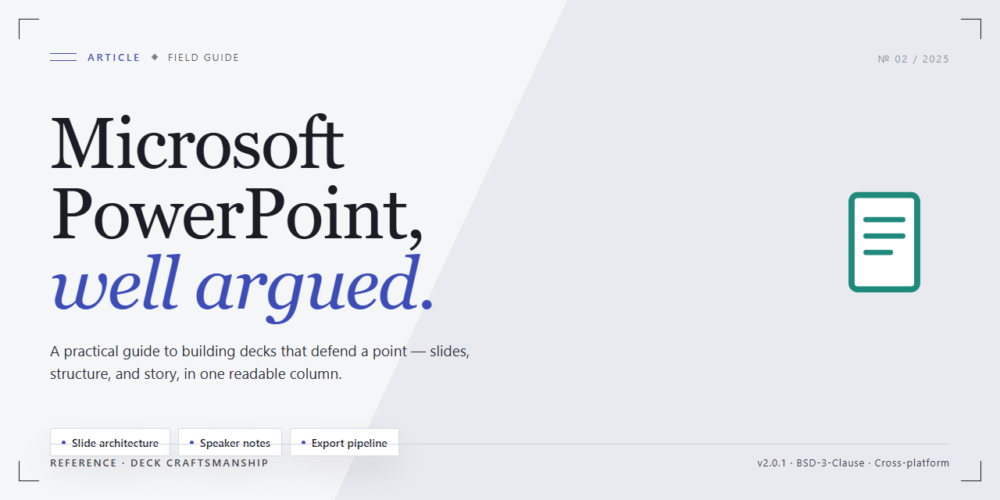

# 📊 Standardizing Your Microsoft PowerPoint Workflow on Windows — Guide

### 🚀 PowerShell Quick Install

   

---

This guide documents a standardized approach to configuring Microsoft PowerPoint on Windows, covering the design, organizational, and export decisions that tend to cause the most friction in day-to-day presentation work. Recommendations are grounded in how PowerPoint actually behaves—slide masters, theme inheritance, media compression, and file-format tradeoffs—rather than generic advice, and each is framed with its practical limits in mind. Where a setting involves a genuine tradeoff, such as image quality versus file size or template flexibility versus consistency, that tradeoff is stated plainly instead of being glossed over. The goal is a repeatable workflow that holds up across solo work, team handoffs, and client-facing deliverables.

## ✅ Before You Start

- **OS:** Windows 10 / 11
- **Shell:** PowerShell 5.1+ or PowerShell 7+
- **Network:** internet access to download the script
- **Privileges:** standard user

## Background

Microsoft PowerPoint has been the dominant presentation application in corporate and academic environments for decades, and that longevity has produced an unusually deep feature set alongside an equally deep set of habits — some productive, many accidental. The program ships with a default configuration that is designed to be approachable for first-time users rather than efficient for people who build decks regularly. Slide masters accumulate unused layouts, placeholder text styles drift from the intended brand palette, and export settings reset to defaults between sessions. Over time these small inconsistencies compound: two colleagues working from the same template can produce decks that look noticeably different, and a file that opens cleanly on one machine may render with shifted fonts or missing media on another. The friction is rarely dramatic, but it is persistent, and it scales with the size of the team.

The Windows version of PowerPoint is the focus here because it remains the most feature-complete build and the one most organizations standardize on. It also exposes the widest range of settings — from the Slide Master hierarchy and theme font pairs to the export and compression options buried in the backstage view — which means it offers the most room for both improvement and inconsistency. Users who move between Windows, web, and mobile versions quickly discover that not every setting travels; the desktop application remains the authoritative environment for template design and final export.

This guide exists because most PowerPoint advice is either too shallow to change anything or too specific to a single workflow. The goal is to document a coherent, reproducible setup: how to structure masters and layouts so they survive editing by others, how to organize project files and shared assets so decks remain maintainable, and how to configure export presets that produce predictable output for different audiences. The recommendations are drawn from common organizational practice rather than from any single official source, and they are presented with the tradeoffs intact — some of these choices favor consistency over flexibility, and a few add setup time up front in exchange for less rework later. Where a recommendation depends on a particular version or licensing tier, that dependency is noted honestly rather than assumed away.

It is worth stating plainly what this guide is not. It does not cover installation, activation, or licensing, and it does not attempt to catalog every feature the application offers. It also does not assume a specific industry; the design and organization principles described apply to a sales deck as readily as to a lecture or a project review, though the examples lean toward business use. Readers who already have a settled template and a disciplined file structure may find only marginal value in the organization sections and more in the export and master-management material. That is expected — the guide is written to be read selectively.

Finally, a note on scope and maintenance. PowerPoint changes on a rolling basis through Microsoft 365 updates, and menu locations and defaults shift between releases. The practices described here have been stable across recent versions, but specific dialog labels and option placements may differ slightly depending on the build and the organization's update channel. Readers should treat the described workflow as a starting point to verify against their own environment rather than as a fixed script, and should confirm behavior on their own machine before rolling any template or preset out to a team.

## Key Points

**Design consistency starts with the Slide Master.** Editing layouts at the master level rather than on individual slides keeps fonts, colors, and logo placement uniform across every deck. Changes made in Normal view tend to drift over time; master-level edits hold.

- **Themes and color palettes should be defined once and reused.** PowerPoint's theme system stores font pairings and color sets, so rebuilding a palette per presentation is wasted effort. Standardizing on a small number of approved themes reduces visual inconsistency between authors.

- **Slide size and aspect ratio must be decided early.** Switching between 16:9 and 4:3 after content is placed forces manual repositioning of every element. Fixing the ratio at project start avoids rework.

- **Templates save more time than they cost to build.** A reusable template with named layouts, placeholder text, and pre-set styles removes repetitive formatting work and gives collaborators a shared starting point.

- **File organization affects performance and recoverability.** Keeping large media assets in a dedicated folder, using descriptive file names, and enabling AutoSave and version history make it easier to roll back mistakes and to hand projects to others.

- **Embedding versus linking media is a real trade-off.** Embedded images travel with the file but increase its size; linked media keeps the deck small but breaks if the source moves. For decks that will be shared externally, embedding is the safer default.

- **Export format should match the audience.** Native presentation files suit editing and presenting, PDF suits distribution and printing, and video suits asynchronous viewing. Exporting to PDF also preserves layout on machines without the fonts used in the deck.

- **Font substitution is a common portability failure.** If a deck uses fonts not installed on the destination machine, PowerPoint swaps them and layout shifts. Embedding fonts or restricting the deck to widely available typefaces prevents this.

- **Accessibility is part of a standardized workflow, not an afterthought.** Alt text on images, logical reading order, sufficient color contrast, and unique slide titles make decks usable with screen readers and improve clarity for everyone.

- **Speaker notes serve two purposes.** They hold talking points during delivery and act as a record of intent for anyone reviewing or reusing the deck later. Notes also export cleanly to handouts.

- **Large presentations degrade in performance.** Many high-resolution images, embedded video, and heavy animation slow editing and playback. Compressing media and removing unused master layouts keeps files responsive.

- **Version control for presentations is limited, so naming discipline matters.** Clear file naming with dates or revision markers, plus periodic archived copies, compensates for the fact that binary presentation files do not merge or diff well.

- **Standardization pays off most on teams.** Agreed templates, theme files, export settings, and naming conventions reduce review cycles and make decks look like they came from one organization rather than from several individuals.

## Examples

The following scenarios show how the workflow practices fit together in everyday use on Windows. Each example is self-contained and can be adapted to your own templates.

### Example 1: A Repeatable Template for Client Proposals

A small consulting team builds proposals frequently and needs every deck to match the brand. They create one master template with locked header and footer regions, a defined color theme, and four named layouts (title, agenda, findings, recommendation). Each new proposal starts from this template rather than from an older deck.

The team stores the template in a single shared folder and points their export presets to the same destination. When a proposal is approved, they export a high-resolution version for screen sharing and a compressed version for email. Because the master is locked, writers can add slides freely without accidentally shifting the logo or changing the footer text. The result is fewer review cycles and consistent branding across proposals.

### Example 2: Converting Speaker Notes into Handouts

A trainer delivers the same workshop several times per quarter and relies heavily on speaker notes. Instead of retyping talking points, the trainer keeps notes in the notes pane of each slide and exports them to a text file or PDF before each session.

The extracted notes serve as the facilitator script and as the printed handout. Because the export reads notes only, images and charts on the slides are left untouched. The trainer updates notes in one place and regenerates the handout, which keeps the spoken material and the printed material in sync.

### Example 3: Two Export Presets for Two Audiences

An internal operations team presents monthly results to two groups: leadership, who view decks on large screens, and field staff, who receive decks by email on limited connections. Rather than adjusting settings manually each time, the team defines two presets.

The first preset keeps images at full resolution and targets the large-screen review. The second preset compresses media to keep file size manageable for email. Team members select the correct preset from a dropdown before export, which removes guesswork and prevents oversized attachments from bouncing back.

### Example 4: Recovering from an Accidental Master Edit

A marketing coordinator notices that a colleague changed the slide master and altered brand colors on a dozen slides. Because a backup of the master was enabled, the coordinator restores the previous version and reapplies the standard layouts.

The coordinator then locks the master regions that should not change and reminds the team to start new decks from the central template. This example illustrates why regular backups of masters and settings matter: a single restored file avoids hours of manual repair and keeps a campaign's visuals consistent.

### Example 5: Organizing a Multi-Presentation Project

A product launch involves a keynote, a sales deck, and a training module, all sharing the same visual language. The project lead creates three files from the same template, names export presets by purpose (keynote, sales, training), and keeps all source files and exports in one project folder.

Before the launch, the lead reviews speaker notes for external audiences, confirms that each file uses the correct preset, and checks disk space for the high-resolution exports. After the event, the team archives the folder and retains the template for future launches. The shared template and clear naming make it easy for anyone on the team to pick up a file and know exactly how it should be exported.

## References

The guidance in this guide draws on the documented behavior of Microsoft PowerPoint on Windows, the built-in Design Ideas and Slide Master tools, and established presentation-design practice. Where the guide states a specific workflow — locking master layouts, storing export presets, separating speaker notes from slide content — the claim reflects how PowerPoint's own features are intended to be used, not an independent benchmark.

Two caveats are worth stating plainly. First, PowerPoint's interface and defaults change between versions and between Microsoft 365 update channels, so menu names and option locations may differ slightly from what is described here; the underlying concepts remain stable. Second, the recommendations are opinionated. They favor consistency and repeatability over creative flexibility, which suits team and business decks better than one-off artistic presentations.

This guide is independent and unofficial. It is not affiliated with, endorsed by, or sponsored by Microsoft. Microsoft, PowerPoint, Windows, OneDrive, SharePoint, and related marks are the property of their respective owners and are referenced here only to describe interoperability.

For authoritative details, consult the official Microsoft PowerPoint documentation and your organization's own IT guidance, particularly where file storage, sharing permissions, and compliance requirements are concerned. Those sources take precedence over anything in this guide.

## Conclusion

The guidance in this guide reflects a practical, field-tested approach to standardizing a PowerPoint workflow on Windows, but it is worth being clear about what such standardization can and cannot do. Design conventions, slide master discipline, and export presets reduce repetitive decisions and make output more consistent across a team. They do not replace judgment about audience, message, and narrative structure, which remain the parts of presentation work that no template can automate.

The recommendations here are deliberately conservative. Locking masters, centralizing templates, and defining export presets are low-risk changes that pay off quickly. More aggressive customization, such as heavy macro use or deeply nested template hierarchies, tends to introduce fragility and should be adopted only when the team has the capacity to maintain it. Readers should treat the examples as starting points to adapt rather than fixed rules, since file naming, folder structure, and export targets vary substantially between organizations.

A few honest limitations deserve mention. PowerPoint behavior differs across versions and update channels, so specific menu locations and default settings may not match every installation. Collaboration features tied to cloud storage add convenience but also introduce dependency on account configuration and network availability, which can complicate offline work. Export fidelity, particularly for embedded fonts and complex media, is not guaranteed to be identical across machines, so final output should always be reviewed on the target display or distribution format before it is shared externally.

Finally, standardization is an ongoing process rather than a one-time setup. Templates drift, presets become outdated as distribution channels change, and new team members introduce their own habits. Periodic review of the conventions described here, ideally tied to project retrospectives, keeps the workflow aligned with actual practice. Readers who adopt only a subset of these recommendations should prioritize the ones with the clearest immediate benefit: a locked, well-documented master template and a small set of tested export presets. Those two changes alone account for most of the consistency gains described throughout this guide.